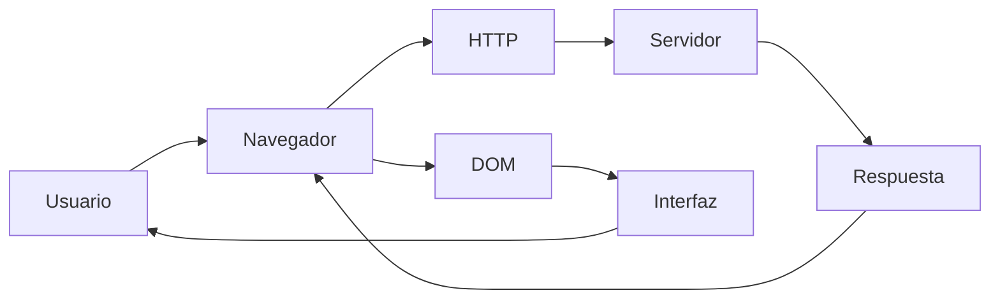
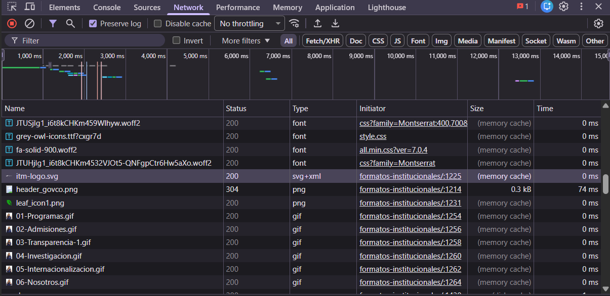
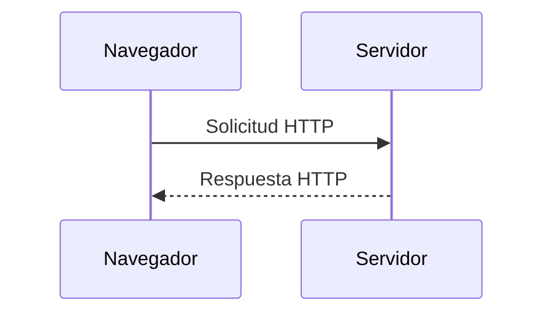
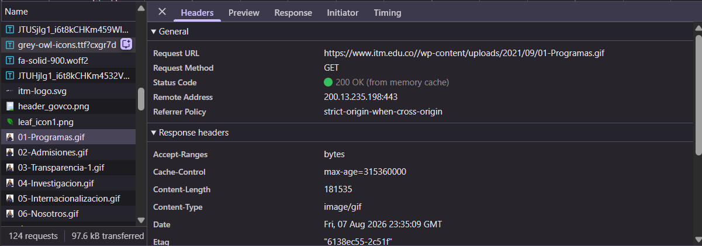
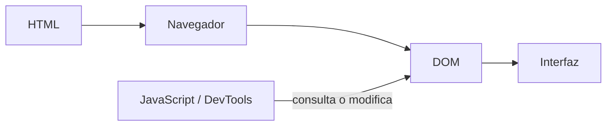
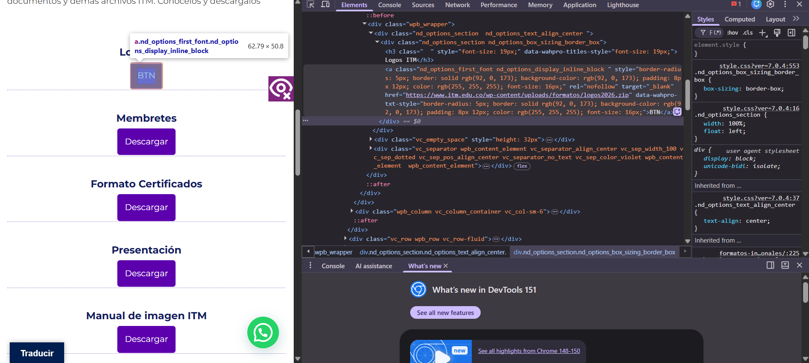
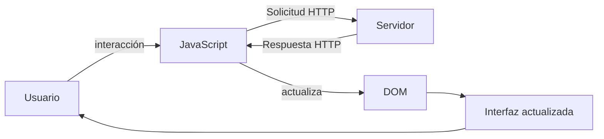
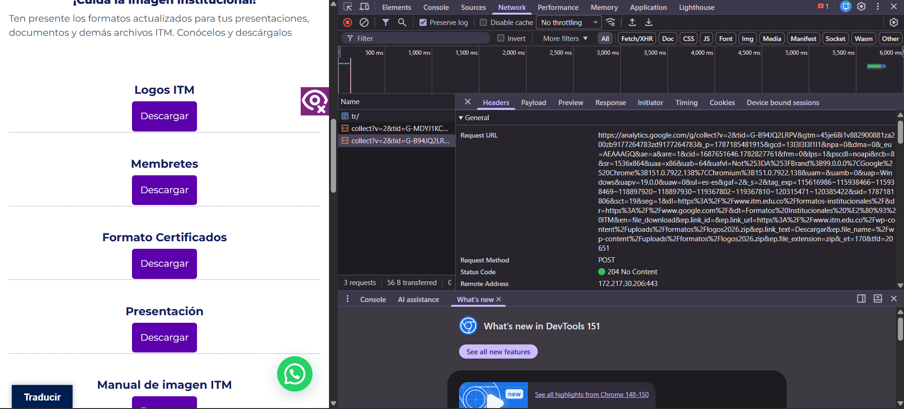
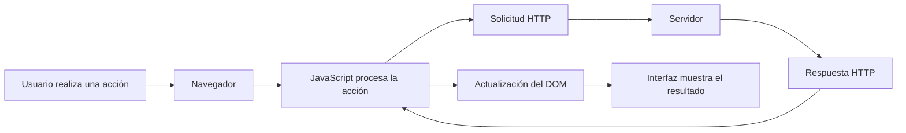

# Laboratorio 01 --- Análisis del funcionamiento de una aplicación web

> **Curso:** Aplicaciones y Servicios Web\
> **Modalidad:** Práctica de laboratorio\
> **Entrega:** Repositorio GitHub --- archivo `README.md`\
> **Evidencias:** Carpeta `evidencias/`

------------------------------------------------------------------------

## Objetivo de la práctica

Analizar el funcionamiento de una aplicación web real mediante las
herramientas de desarrollo del navegador, identificando los recursos
cargados, las solicitudes y respuestas HTTP, la estructura DOM y las
interacciones entre cliente y servidor.

## Resultado esperado

Al finalizar la práctica, el estudiante deberá poder reconstruir y
documentar el flujo observado entre:



> El diagrama anterior representa los **componentes que serán
> analizados**. El diagrama final de la práctica deberá ser construido
> por el estudiante a partir de sus propias observaciones.

------------------------------------------------------------------------

# 1. Preparación del entorno

1.  Ingrese a la aplicación web indicada por el docente.
2.  Abra las **herramientas de desarrollo** del navegador.
3.  Identifique las herramientas **Red / Network** y **Elementos /
    Elements**.
4.  Cree la siguiente estructura dentro del repositorio:

``` text
laboratorio-01/
├── README.md
└── evidencias/
```

El archivo `README.md` será el informe de la práctica. La carpeta
`evidencias/` contendrá las capturas utilizadas para sustentar los
resultados.

------------------------------------------------------------------------

# 2. Identificación de recursos de la aplicación

Abra la herramienta **Red / Network** y recargue completamente la
aplicación.

Observe las solicitudes generadas durante la carga e identifique como
mínimo **cinco recursos**, procurando seleccionar tipos diferentes:
documento HTML, CSS, JavaScript, imágenes, fuentes u otros.

## Resultados

Complete la tabla:

  Recurso   Tipo   Dominio     Tamaño
  --------- ------ --------- --------
    sexySelect.min.css?ver=1.04 | CSS | itm.edu.co | 2491
    jquery.min.js?ver=3.7.1| JS | itm.edu.co | 87553
    01-Programas.gif | gif | itm.edu.co | 181535
    leaf_icon1.png | png | itm.edu.co | 1102
    itm-logo.svg | svg | itm.edu.co | 13002
                             
                             
                             
                             

**Total de solicitudes observadas:** `124`

## Evidencia

Guarde una captura de la pestaña Network como:

``` text
evidencias/network.png
```

Inclúyala aquí:

``` markdown

```

### Análisis

**¿Por qué una sola URL puede generar múltiples solicitudes HTTP?**

> La pagina del itm genera multiples solicitudes debido a que hay muchos recursos para armar correctamente, textos, fuentes, imagenes, gif, js, entre otros, realiza una peticion. 

------------------------------------------------------------------------

# 3. Análisis de una solicitud HTTP

En **Network**, seleccione una de las solicitudes realizadas por el
navegador, preferiblemente la correspondiente al documento principal.

Identifique la información solicitada a continuación.

  Elemento              Resultado
  --------------------- -----------
  URL                 : https://www.itm.edu.co//wp-content/uploads/2021/09/01-Programas.gif  
  Método HTTP           GET
  Código de estado      200 
  Host / dominio        itm.edu.co
  Tipo de recurso       gif
  Tiempo de respuesta   0ms 

## Flujo que se está observando



## Evidencia

Guarde una captura de los detalles de la solicitud como:

``` text
evidencias/request.png
```

Inclúyala en el informe:

``` markdown

```

### Análisis

**¿Qué recurso solicitó el navegador?**

> El navegador solicitud el recurso de imagen png para una mejor visualizacion 

**¿Qué información permite determinar si la solicitud fue atendida
correctamente?**

>El Status Code permite saber si la solicitud fue atendida en este caso funciona correctamente y muestra el 200

------------------------------------------------------------------------

# 4. Inspección del DOM

Seleccione un elemento visible de la aplicación, por ejemplo:

-   un botón;
-   un título;
-   un enlace;
-   un campo de formulario;
-   un elemento del menú.

Utilizando **Elementos / Elements**:

1.  Localice el elemento dentro del DOM.
2.  Identifique la etiqueta HTML utilizada.
3.  Modifique temporalmente su contenido desde las herramientas de
    desarrollo.
4.  Observe el cambio producido en la interfaz.
5.  Registre la evidencia.

## Resultados

**Elemento seleccionado:** `boton`

**Etiqueta HTML:** `a`

**Contenido original:** `Descargar`

**Modificación realizada:** `BTN`

El proceso observado puede representarse conceptualmente así:



## Evidencia

Guarde la captura como:

``` text
evidencias/dom.png
```

Inclúyala aquí:

``` markdown

```

### Análisis

**¿La modificación realizada sobre el DOM alteró permanentemente la
aplicación o los archivos almacenados en el servidor? Justifique.**

> Ese cambio no modifica el archivo permanetemente el archivo ya que no estamos modificando el archivo original almacenado
solamente es una vision local en el momento.

------------------------------------------------------------------------

# 5. Análisis de una interacción dinámica

Regrese a **Network** y limpie las solicitudes registradas.

Realice una acción dentro de la aplicación que pueda generar una
interacción con el servidor, por ejemplo:

-   consultar;
-   buscar;
-   filtrar;
-   seleccionar una opción;
-   enviar información.

Observe si aparece una nueva solicitud en Network.

## Resultados

  Elemento                       Resultado
  ------------------------------ -----------
  Acción realizada                  Presional boton            
  ¿Generó una nueva solicitud?      Si, genero unas solicitudes en JS
  URL solicitada                    https://analytics.google.com/g/collect?v=2&tid=G-B94JQ2LRPV&gtm=45je68i1v882900881za200zb9177264783zd9177264783&_p=1787185481915&gcd=13l3l3l3l1l1&npa=0&dma=0&_eu=AEAAAGQ&ae=a&are=1&cid=1687651646.1782827761&frm=0&lps=1&pscdl=noapi&rcb=8&sr=1536x864&uaa=x86&uab=64&uafvl=Not%253DA%253FBrand%3B99.0.0.0%7CGoogle%2520Chrome%3B151.0.7922.138%7CChromium%3B151.0.7922.138&uam=&uamb=0&uap=Windows&uapv=19.0.0&uaw=0&ul=es-es&gaf=2&_s=2&tag_exp=115616986~115938466~115938469~118897920~118897930~119367802~119367810~120315471~120385422&sid=1787181806&sct=19&seg=1&dl=https%3A%2F%2Fwww.itm.edu.co%2Fformatos-institucionales%2F&dr=https%3A%2F%2Fwww.google.com%2F&dt=Formatos%20Institucionales%20%E2%80%93%20ITM&en=file_download&ep.link_id=&ep.link_url=https%3A%2F%2Fwww.itm.edu.co%2Fwp-content%2Fuploads%2Fformatos%2Flogos2026.zip&ep.link_text=Descargar&ep.file_name=%2Fwp-content%2Fuploads%2Fformatos%2Flogos2026.zip&ep.file_extension=zip&_et=170&tfd=20651

  Método HTTP                       POST                
  Código de estado                  204
  Tipo de respuesta                 Descarga

## Ciclo de interacción

Utilice este esquema únicamente como referencia conceptual para
interpretar lo observado:



## Evidencia

Guarde la captura como:

``` text
evidencias/interaccion.png
```

Inclúyala aquí:

``` markdown

```

### Análisis

**Explique la relación entre la acción realizada por el usuario y la
solicitud observada.**

> Cada accion por mas pequeña que sea genera una solicitud

------------------------------------------------------------------------

# 6. Reconstrucción del flujo observado

A partir de **sus propias evidencias**, construya un diagrama Mermaid
que represente el funcionamiento de la aplicación analizada.

El diagrama deberá incluir, cuando corresponda:

`Usuario` · `Navegador` · `JavaScript` · `Solicitud HTTP` · `Servidor` ·
`Respuesta HTTP` · `DOM` · `Interfaz`

> **No copie los diagramas anteriores.** Esta sección debe representar
> el flujo que usted pudo comprobar durante la práctica.

Reemplace el siguiente bloque con su diagrama:



------------------------------------------------------------------------

# 7. Observado vs. inferido

Una herramienta de desarrollo permite observar una parte del sistema,
pero no necesariamente todo lo que ocurre en el servidor.

Clasifique sus hallazgos:

## Elementos observados directamente

-Se observó en Network que al realizar la acción sobre el botón “Descargar” el navegador generó una solicitud HTTP POST hacia analytics.google.com/g/collect.
-Se observaron directamente los datos de la solicitud, incluyendo el método HTTP POST, el código de estado 204 y los parámetros asociados al evento file_download, donde se identifica el enlace de descarga.
-Se observó en Elements que el botón correspondía a una etiqueta HTML <a> y que al modificar su contenido de Descargar a BTN el cambio se reflejó inmediatamente en la interfaz.

## Elementos inferidos

-Se infiere que JavaScript interviene en el procesamiento de la interacción, debido a que la acción sobre el enlace produjo una solicitud adicional de seguimiento registrada en Network.
-Se infiere que el servidor de Google Analytics recibe y procesa la información asociada al evento de descarga, aunque el procesamiento interno no puede observarse directamente desde las herramientas del navegador.
-Se infiere que la aplicación utiliza mecanismos del lado del cliente para gestionar o registrar determinadas interacciones del usuario, pero la lógica interna exacta de estos mecanismos no puede determinarse únicamente mediante Network y Elements.
> No presente como observado un proceso interno que las herramientas del
> navegador no permitan comprobar directamente.

------------------------------------------------------------------------

# 8. Conclusiones

Redacte **tres conclusiones técnicas** derivadas de la práctica.

1. La aplicación web está compuesta por múltiples recursos y solicitudes HTTP, ya que durante la carga de la página del ITM se observaron 124 solicitudes correspondientes a archivos CSS, JavaScript, imágenes, fuentes y otros recursos necesarios para construir la interfaz.
2. La interacción del usuario puede generar solicitudes adicionales, como se comprobó al presionar el botón “Descargar”, acción que produjo una solicitud POST hacia Google Analytics con el evento file_download y código de estado 204. Esto evidencia que algunas interacciones son registradas mediante mecanismos ejecutados desde el navegador.
3. Las herramientas de desarrollo permiten observar el comportamiento del lado del cliente, pero no todos los procesos internos del servidor. La inspección del DOM permitió modificar temporalmente un elemento de la interfaz, mientras que Network permitió analizar las solicitudes y respuestas HTTP; sin embargo, la lógica interna del servidor y el procesamiento de los datos solo pueden inferirse a partir de estas evidencias.

Las conclusiones deben explicar lo aprendido a partir de la evidencia y
no limitarse a describir las actividades realizadas.

------------------------------------------------------------------------

# 9. Entrega

La estructura final esperada es:

``` text
laboratorio-01/
├── README.md
└── evidencias/
    ├── network.png
    ├── request.png
    ├── dom.png
    └── interaccion.png
```

Antes de entregar, verifique:

-   [ ] El `README.md` se visualiza correctamente en GitHub.
-   [ ] Las imágenes se muestran dentro del README.
-   [ ] Se documentaron al menos cinco recursos.
-   [ ] Se analizó una solicitud HTTP.
-   [ ] Se identificó y modificó un elemento del DOM.
-   [ ] Se analizó una interacción de la aplicación.
-   [ ] El diagrama final corresponde a lo observado.
-   [ ] Se diferenciaron elementos observados e inferidos.
-   [ ] Se redactaron tres conclusiones técnicas.
-   [ ] Se realizó `commit` y `push` al repositorio.

------------------------------------------------------------------------

## Criterio de documentación

> **Las capturas son evidencia, no la respuesta.**

Cada evidencia debe estar acompañada por una explicación que indique
**qué se observó, qué significa y cómo se relaciona con el
funcionamiento de la aplicación web**.
